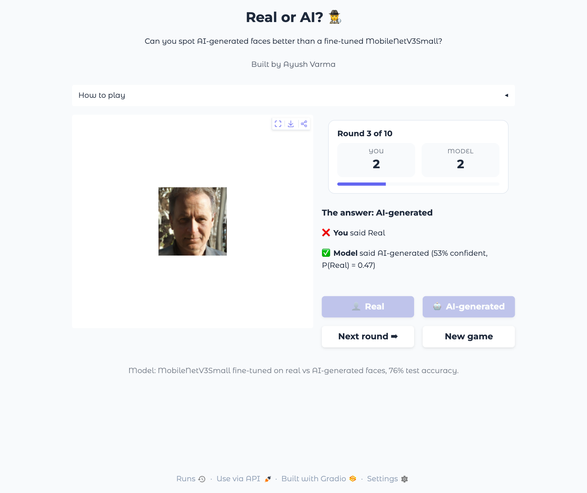

# Real vs AI-Generated Face Detection

## What this project is about

Can a model tell a real photo of a face from one made by an image generator? This project builds that classifier step by step, from a plain neural network up to a fine-tuned MobileNetV3, and explains why each step was needed. It ends with a small Gradio game where a person competes against the best model.

Topics covered:
- Image classification with Keras (MLP, CNN, transfer learning, fine-tuning)
- Data augmentation for faces
- Debugging BatchNorm behaviour on a small dataset
- Choosing what to freeze and what to train in a pretrained network
- Evaluation beyond accuracy: confusion matrices, precision and recall, model disagreement
- Serving a saved model in an interactive Gradio app

## The dataset

- Face images in two classes: **real** photos and **AI-generated** faces.
- 600 images per class are used for training and validation, plus a separate fixed test set of 150 per class.
- Split: 1,020 train, 180 validation, 300 test. Every split is balanced, so 50% accuracy is a coin flip.
- Every image is resized to 128 x 128 RGB and scaled to [0, 1].

What I noticed before training:
- The average AI face is sharper than the average real face: generated faces are more consistently aligned and framed.
- The average real face shows a faint 8 x 8 grid, likely from JPEG compression.
- So a model could learn shortcuts (face position, compression) instead of real generation artifacts. This shaped the augmentation choices below.

## How I approached it

### 1. Baselines: MLP and small CNN

The data loader and the two baseline models come from a provided template. I used them to understand the problem before building my own models.

- **MLP:** Flatten, then Dense(128), Dense(64), sigmoid. It has 6.3M parameters, 99.9% of them in the first layer, for only 1,020 images, and flattening throws away the spatial layout. It overfits: train accuracy about 0.81, validation jumping between 0.52 and 0.71.
- **CNN:** three Conv-BatchNorm-ReLU-MaxPool blocks (16, 32, 64 filters) and global average pooling. Only 30,641 parameters thanks to weight sharing. Validation accuracy sat at exactly 0.500 for about the first 12 epochs, which means it predicted one class for every image. That pointed to a BatchNorm problem, investigated next.

### 2. Data augmentation

Augmentation layers sit inside the model, right after the input, so they only run during training and never touch validation or test images.

| Layer | Setting | Why |
|---|---|---|
| RandomFlip | horizontal | A mirrored face is still a real-looking face |
| RandomRotation | 0.03 (about ±11°) | Natural head tilt, kept small because rotation blurs pixels |
| RandomZoom | 0.1 | Breaks the fixed framing of AI faces |
| RandomTranslation | 0.1, 0.1 | Moves the eyes off fixed pixel positions (alignment shortcut) |
| RandomContrast | 0.1 | Different cameras and lighting |

Left out on purpose: vertical flips and large rotations (unrealistic faces), and blur or noise (they would erase the fine texture that may reveal generation).

**BatchNorm debugging.** The augmented CNN still predicted "AI" for 92% of validation images. On the training images it scored 0.70 in training mode but 0.555 in evaluation mode. Evaluation mode removes augmentation and dropout, so the task should get easier, not harder. That rules out overfitting and points to BatchNorm: its running mean and variance did not match the batch statistics used in training. Lowering BatchNorm momentum from 0.99 to 0.9 (only 32 steps per epoch) helped in one run but not reliably.

**Checkpoint choice.** The checkpoint monitors `val_accuracy`, not `val_loss`. In an early run `val_loss` saved epoch 1, whose loss of 0.6932 = -log(0.5) belongs to a model that outputs 0.5 for every image. Conclusion: a 30K-parameter CNN trained from scratch on 1,020 images plateaus around 60% validation accuracy. Augmentation limits memorization but cannot add visual knowledge the model does not have. That is the reason for transfer learning.

### 3. Transfer learning with MobileNetV3Small (frozen backbone)

**Why MobileNetV3Small:** it is a small CNN built for phones and edge devices, pretrained on ImageNet (1.4M images). Its early and middle layers already detect edges, textures and shapes, which 1,020 face images cannot teach from scratch. It is small enough (939,120 parameters, 158 layers) to train on a CPU.

**How I used it:**
- `include_top=False` drops the 1,000-class ImageNet classifier; `pooling='avg'` turns each image into one 576-number feature vector.
- **Input scaling:** Keras MobileNetV3 has a built-in rescaling layer and expects pixels in [0, 255]. My data was in [0, 1], so I multiplied by 255. Feeding [0, 1] raises no error; it just performs badly without telling you.
- **All 158 backbone layers frozen** (`base.trainable = False`). Only the new head learns, and BatchNorm keeps its ImageNet statistics, so the BatchNorm problem from step 2 cannot happen.
- The 128 x 128 input works even though the weights were made for 224 x 224, because the backbone is fully convolutional and ends in global pooling.

**Two heads compared**, with everything else identical:
- Head A: Dropout, Dense(1). 577 trainable parameters, essentially logistic regression on ImageNet features.
- Head B: Dropout, Dense(128, ReLU), Dropout, Dense(1). 73,985 trainable parameters, can combine features non-linearly.

Head B had higher validation accuracy across most epochs (best 0.756 vs 0.694), so I picked it. I chose on validation, not test, so the test set stays unbiased.

### 4. Fine-tuning

Starting point: the trained Head B model, loaded from its checkpoint. A trained head sends useful gradients into the backbone; a random head would send large, meaningless ones and damage the pretrained weights.

What I unfroze and why:
- **Last 30 of 158 backbone layers unfrozen.** Early layers hold generic edge and texture detectors that suit any image. Late layers hold ImageNet-specific features that need to adapt to faces.
- **The 6 BatchNorm layers inside those 30 stay frozen**, so 24 layers train. A trainable BatchNorm layer would overwrite ImageNet's running statistics with statistics from batches of 32 faces. Those statistics update by momentum, not by gradients, so a small learning rate does not protect them.
- Order of operations: unfreeze everything, refreeze all but the last 30, then refreeze the BatchNorm layers among them. Then **recompile**, because Keras fixes the list of trainable weights at compile time.
- Trainable parameters: 642,785 (73,985 head + 568,800 backbone). The last 30 layers hold about 60% of the backbone weights because late layers have many channels.
- **Learning rate 1e-5**, 100x smaller than for the head, to nudge the pretrained weights instead of overwriting them.
- **Checkpoint and EarlyStopping** (patience 5, restore best weights), both on validation accuracy.

Result: best validation accuracy 0.778 at epoch 7; early stopping ended training at epoch 12 and restored epoch 7. Epoch 1 already matched the frozen model, so the pretrained features were not disrupted.

Lesson learned: `monitor` and `mode` must agree. An early attempt used `monitor='val_loss'` with `mode='max'`, which treated rising loss as improvement, stopped while the model was still improving, and restored the worst epoch.

### 5. Evaluation

- One table of best validation and test accuracy for all five models, with the 50% chance line.
- Confusion matrices and per-class accuracy, to see whether a model favours one class.
- Precision and recall with "AI" as the class being detected.
- Images grouped by how many of the five models get them right, and a majority vote of all five.
- Noise check: with 180 validation images, one standard error near 0.7 accuracy is about ±3.5 points; with 300 test images about ±2.5 points. Small gaps between models are within noise.

## Results

| Model | Trainable params | Best val acc | Test acc |
|---|---|---|---|
| MLP | 6,299,905 | 0.706 | 0.667 |
| CNN | 30,225 | 0.589 | 0.670 |
| CNN + augmentation | 30,225 | 0.578 | 0.607 |
| MobileNetV3Small, frozen, Head B | 73,985 | 0.756 | 0.723 |
| MobileNetV3Small, fine-tuned | 642,785 | 0.778 | **0.763** |

What the numbers say:
- Fine-tuning's whole gain came from the AI class: AI faces caught rose from 96 to 108, real faces recognized stayed at 121.
- Both MobileNets favour precision: when they flag a face as AI they are right 77 to 79% of the time, but they miss fakes (recall 0.64 frozen, 0.72 fine-tuned).
- 8 of 300 test images fool all five models: photorealistic AI faces with natural backgrounds, some called "Real" with 0.97 confidence. At 128 x 128, fine generation artifacts are likely lost.
- A majority vote of all five models scores 0.737, below the fine-tuned model alone, because the three weaker models outvote the two stronger ones.

## The game: serving the model with Gradio

`game/app.py` turns the saved model into a small web game. Each round shows a held-out test face, you guess Real or AI, then you see the true label and the model's guess with its confidence. After 10 rounds a summary shows who won.



How the app serves the model:
- **Load once.** `keras.models.load_model("best_model.keras")` runs when the app starts, not on every click, so each prediction is a single forward pass.
- **Same preprocessing as training.** `predict_real_prob()` opens the image as RGB, resizes it to 128 x 128 and converts it to float32 in [0, 255], with no division by 255, because the MobileNetV3 backbone rescales its input itself. A mismatch here would not crash, it would just give wrong predictions.
- **Prediction to answer.** The sigmoid output is P(Real). The model says Real when P(Real) >= 0.5, and its confidence is P(Real) or 1 - P(Real), whichever is larger.
- **Labels from folders.** Images live in `test_images/real/` and `test_images/ai/`, so the folder name is the true label. They are saved as PNG, so the pixels match what the model was evaluated on.
- **Per-player state.** `gr.State` holds each browser session's 10 randomly chosen images, current round and both scores, so two people playing at once do not share a game.
- **UI with `gr.Blocks`.** An image panel, an HTML scoreboard with a progress bar, a Markdown feedback area and four buttons. Each event handler returns the new state plus `gr.Button(interactive=...)` updates, so the guess buttons switch off after a guess and a round cannot be answered twice.
- **Launch.** `demo.launch(theme=..., css=...)` serves the app at `localhost:7860` (in Gradio 6, theme and CSS go to `launch()`).

Before building the UI, `check_model.py` loaded the saved model in a fresh local environment and scored it on the 40 game images: 0.78, in line with the 0.763 test accuracy. That confirmed the saved model and the preprocessing match the notebook.

## Repository layout

```
notebooks/face_detection_training.ipynb   data, all five models, evaluation
game/app.py                               Gradio game
game/check_model.py                       sanity check of the saved model
game/best_model.keras                     fine-tuned MobileNetV3Small
game/test_images/{real,ai}/               40 held-out test faces
game/requirements.txt                     pinned versions for the game
docs/game_screenshot.png                  screenshot used in this README
```

## How to run

Notebook: open `notebooks/face_detection_training.ipynb` in Google Colab and run the cells in order. The first data cell downloads the dataset into `/content/` (change `output_path` and `data_path` to run it elsewhere). All outputs shown come from one complete, in-order run on a Colab CPU runtime.

Game:

```bash
cd game
python3.12 -m venv .venv && source .venv/bin/activate
pip install -r requirements.txt
python app.py
```

Then open http://localhost:7860. To check the saved model on its own, run `python check_model.py` from the same folder.

TensorFlow and Keras are pinned to the versions used for training so that `best_model.keras` loads.

## Tech stack

Python 3.12, TensorFlow 2.20, Keras 3, scikit-learn, NumPy, Pillow, Matplotlib, Seaborn, Gradio 6.
